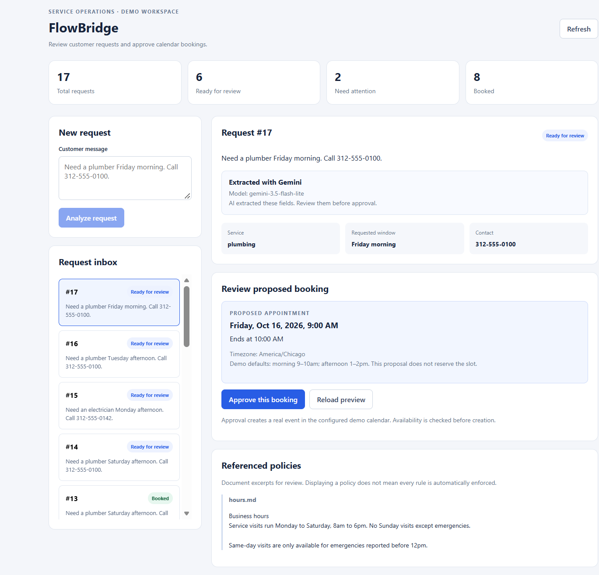

# FlowBridge

AI-assisted service request automation with human approval and a real
Google Calendar integration.

FlowBridge turns customer messages into structured requests, collects
missing information, presents policy evidence and an appointment
proposal, and executes the booking after operator approval.

**Status:** Working local portfolio demo. No hosted application yet.

## Business workflow

Service teams receive incomplete, unstructured requests and must
translate them into reliable operational actions.

FlowBridge demonstrates this process for HVAC, plumbing, and electrical
service visits:

1. Submit a customer message.
2. Extract service, requested time window, and contact using Gemini.
3. Validate the output, falling back to deterministic rules if needed.
4. Reject unsupported requests or collect missing details.
5. Review policy excerpts and an exact appointment proposal.
6. Approve the saved proposal.
7. Check calendar availability and create the event.
8. Record the outcome and support retries after connector failures.

The dashboard shows whether Gemini or fallback rules handled the
initial extraction. A preview does not reserve a slot.

This project uses fictional requests and a separate demo calendar.
It has not been deployed for real customers.

## Technology

| Component | Technology |
|---|---|
| Backend | Python, FastAPI, Pydantic |
| Frontend | React, TypeScript, Vite |
| Persistence | SQLite and SQL |
| AI extraction | Gemini API with structured JSON output |
| External integration | Google Calendar API and Desktop OAuth |
| Policy retrieval | Topic-gated keyword retrieval from Markdown |
| Validation | pytest, FastAPI TestClient, extraction evaluations |

Policy retrieval is deterministic. This version does not implement
embedding-based retrieval or RAG answer generation.

## Example

> Need a plumber Wednesday morning. Call 312-555-0100.

The application extracts `plumbing`, `Wednesday morning`, and the phone
number, then proposes a dated appointment in `America/Chicago`.

Demo defaults:

- Morning: 9–10 AM
- Afternoon: 1–2 PM
- Sunday visits are blocked.
- Same-day and emergency handling require further implementation.

Approval creates a real event in the configured demo calendar without
sending customer invitations.

## Architecture

| File | Responsibility |
|---|---|
| `frontend/src/App.tsx` | Operator dashboard and review workflow |
| `frontend/src/api.ts` | Typed backend API client |
| `app/main.py` | Endpoints and request state transitions |
| `app/extract.py` | Gemini extraction, validation, and fallback rules |
| `app/policies.py` | Relevant policy excerpts and scheduling checks |
| `app/calendar_api.py` | Saved proposals and calendar execution |
| `app/db.py` | Request persistence and execution history |
| `policies/` | Business policy documents |
| `tests/` | Isolated workflow and policy tests |
| `evals/` | Labeled cases, evaluation runner, and saved reports |

SQLite stores requests, extracted fields, policy evidence, execution
history, and the saved calendar payload used for retries.

## Local setup

Requires Python 3.11+ and Node.js with npm.

From a fresh checkout:

```powershell
git clone https://github.com/Rounakladdha8/flowbridge.git
cd flowbridge
python -m venv .venv
.\.venv\Scripts\python.exe -m pip install -r requirements.txt
```

### Configure Gemini

Copy the example configuration:

```powershell
Copy-Item .env.example .env
```

Edit `.env` locally:

```dotenv
GEMINI_API_KEY=YOUR_PRIVATE_KEY
GEMINI_MODEL=gemini-3.5-flash-lite
```

The extractor loads `.env` from the repository root. Without a key, or
when an API call or validation fails, it uses fallback rules.

Model availability and API quotas depend on the Google project.
Use fictional customer data for this demonstration.

Never commit `.env` or API keys.

### Configure Google Calendar

1. Create a separate private demo calendar.
2. Enable the Google Calendar API in a Google Cloud project.
3. Configure the OAuth consent screen and test users.
4. Create a Desktop OAuth client.
5. Save its downloaded credentials as `credentials.json` in the
   repository root.
6. Run:

```powershell
.\.venv\Scripts\python.exe authorize_calendar.py
```

Authorization creates `token.json`.

Create `calendar_config.json` in the repository root:

```json
{
  "calendar_id": "YOUR_DEMO_CALENDAR_ID",
  "timezone": "America/Chicago"
}
```

Use the separate calendar's ID. The connector rejects `primary`.

Credentials, tokens, actual calendar configuration, `.env`, and local
databases are excluded through `.gitignore`.

### Start the backend

```powershell
.\.venv\Scripts\python.exe -m uvicorn app.main:app --host 127.0.0.1 --port 8000
```

Local endpoints, available while the backend is running:

- Health: `http://127.0.0.1:8000/health`
- API documentation: `http://127.0.0.1:8000/docs`

The backend root `/` returns 404 because it has no webpage.

### Start the frontend

In a second terminal, from the repository root:

```powershell
cd frontend
npm ci
npm run dev
```

Open the Local URL printed by Vite, usually `http://localhost:5173`.

The frontend proxies `/api` requests to port 8000. Both servers must be
running to use the complete application.

These localhost addresses are local development URLs, not hosted demos.

## Tests and evaluations

From the repository root:

```powershell
.\.venv\Scripts\python.exe -m pytest tests/test_flow.py tests/test_policies.py -q
```

Frontend type checking and production build:

```powershell
cd frontend
npm run build
```

Offline rule-based extraction evaluation:

```powershell
.\.venv\Scripts\python.exe -m evals.run_eval --mode rules
```

Live Gemini sample evaluation:

```powershell
.\.venv\Scripts\python.exe -m evals.run_eval --mode gemini --limit 5
```

Run evaluation commands from the repository root. Evaluations create
no requests or calendar events; Gemini mode makes external API calls.

### Recorded results

| Check | Result |
|---|---|
| Automated workflow and policy tests | 12 passed |
| TypeScript checking and Vite build | Passed |
| Rule-based extraction | 21/21 cases matched all four labeled fields |
| Gemini sample extraction | 5/5 cases matched all four labeled fields |
| Gemini sample fallback count | 0 |
| Real calendar creation | Verified manually |
| Occupied-slot rejection | Verified manually |

Reports are saved in `evals/results/rules.json` and
`evals/results/gemini.json`.

These are small development datasets, not estimates of production
accuracy. The five Gemini cases are complete service requests and do
not establish performance on unsupported or adversarial messages.

Automated workflow tests use temporary databases and a mocked calendar
connector. They do not validate the real Google API or connector
concurrency behavior.

## Reliability

- Missing information and supported scheduling violations block approval.
- Scheduling checks are repeated before calendar execution.
- Approval references the specific saved proposal ID.
- The dated calendar payload and event ID are persisted before execution.
- Retries reuse that ID and look for an existing event before insertion.
- Repeated approval of a booked request returns its recorded result.
- Connector successes and failures appear in execution history.
- Availability checks ignore cancelled events and events marked free.

A process-local lock serializes connector calls within one server
process. Calendar availability checking and insertion are separate API
operations, so other writers or multiple server processes can still
introduce booking conflicts.

## Demo walkthrough

1. Submit a complete fictional request and inspect its extraction method.
2. Review the dated booking proposal.
3. Approve it and inspect the demo calendar.
4. Submit a request without contact information and add clarification.
5. Submit a Sunday request and correct its schedule.
6. Submit an account-billing question and observe rejection.
7. Use the demo failure control on a new, available slot and retry.

Do not repeatedly create separate requests for the same occupied slot.
Use a booked request's history to demonstrate its completed execution.

## Implementation issues investigated

- Tightened service matching so `account` does not match `ac`.
- Preserved service/contact fields during scheduling clarification.
- Resolved configuration files relative to the project directory.
- Added extraction-method tracking to distinguish AI from fallback.
- Updated the model configuration after the API reported an unavailable model.
- Added topic gates to prevent unrelated cancellation and service-area excerpts.

## Current limitations

- No operator authentication or role-based access control.
- The demo failure endpoint is unprotected.
- Desktop OAuth is intended for this local demonstration.
- No hosted deployment or multi-user OAuth flow.
- Cancellation and service-area policies are evidence for review;
  their rules are not enforced.
- No emergency scheduling, cancellation execution, or rescheduling flow.
- Fixed appointment times and limited natural-language date handling.
- Expired saved proposals require a new request.
- Clarification preserves the initial extraction metadata; the dashboard
  does not provide separate provenance for every later field correction.
- No multi-tenant isolation, load testing, or production SLA claims.

## Development approach

Developed with AI coding assistance. The project includes local
integration setup, debugging, workflow testing, and evaluation of the
resulting behavior.

## FDE relevance

FlowBridge demonstrates translating a business process into a full-stack
application, integrating external systems, investigating implementation
failures, validating behavior, and documenting delivery trade-offs.

The service-business scenario is an example. Adapting the workflow to
another sector would require changing the data model, policies,
integrations, and evaluation cases.

